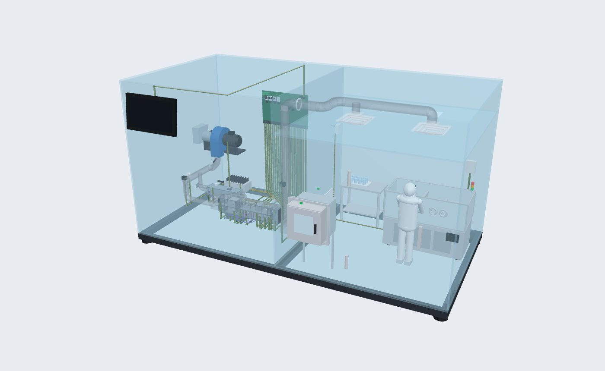

# Clean-Room Heat-Recovery Air-Pump Test Rig

**Done by Eng. Kariem Moussa, under the supervision of Dr. Eng. Ahmed Maher**
Department of Pharmaceutical Engineering, German International University (GIU)

A 1.0 × 0.5 m acrylic test rig, 0.5 m high. The first half is the **plant room**. It holds the AHU and the heat-recovery air pump working in parallel. Both are the same units as the earlier 3D model on the project website, with the same parts and layout, scaled to fit. The second half is a **clean room**. It is supplied through a duct riser and two ceiling diffusers, and the air returns through low-level grilles. A fresh-air compressor feeds outdoor air to both units, and the exhaust leaves through the air pump's evaporator. Every sensor and actuator is wired through PCB, and a touch-screen HMI runs the rig.

This repository has two parts:

| | What | Where |
|---|---|---|
| **3D simulation** | An interactive, live-running digital twin with HMI, control loops, energy, CO₂ and ACH | [`index.html`](index.html) |
| **3D CAD design** | A STEP assembly that SolidWorks opens directly, with 246 named and coloured parts in 8 sub-assemblies | [`cad/`](cad/) |


### Open the simulator
- **Online:** enable GitHub Pages (Settings → Pages → *Deploy from a branch* → `main` / root). The rig is then live at **https://kariemm11.github.io/Cleanroom-Heat-Recovery-Air-Pump/**.
- **Offline:** open `index.html` in a browser. Everything except the web fonts is in this repository: Three.js is in `assets/vendor/`.

---

## What is in the box

| Zone | Contents |
|---|---|
| **Plant room** (x < 0) | **AHU**: outdoor-air pre-filter, plate core or thermal wheel, recovery bypass damper, mixing box with **servo-driven dampers**, panel + bag filters, **pre-heat coil**, cooling coil, droplet eliminator, **reheat coil**, steam humidifier, EC supply fan, H13 HEPA, attenuators, extract deck with transfer fan. **Heat-recovery air-pump unit**, in parallel behind it: crossflow core, two filters, exhaust-air coil (the air pump's evaporator), fans, control box. One R32 circuit (scroll compressor, 4-way valve, EEV) joins the two. |
| **Fresh air** | **Fresh-air compressor** (centrifugal, PWM speed) behind a wall louvre. It discharges into a header with one branch to the air-pump unit's fresh lane and one to the AHU's outdoor-air intake. |
| **Supply** | AHU supply → boot → **riser** (FT-102 airflow) → through the partition → ceiling-void duct → **two 4-way square ceiling diffusers** under a false ceiling at 400 mm. |
| **Return / exhaust** | **Two low-level return grilles** in the partition → AHU extract deck → recirculated through the mixing box, or exhausted through both cores and the evaporator → outdoor louvre. |
| **Clean room** (x > 0) | 492.5 × 490 × 395 mm net (V = 0.0953 m³). Human scale inside is about 1:7. It holds a **vial filling machine** under ceiling diffuser 2 (infeed turntable, conveyor, 4-needle filling with product tank and peristaltic pump, stoppering, outfeed table, open RABS with glove ports, light tower). There is a **pass box** through the front wall beside the door, with interlocked inner and outer doors and a UV cycle, and a **gowned operator** working at the RABS gloves. Also a staging bench, LED luminaire, room T + RH, room ΔP and a hinged access door. The filler and the pass box are stand-alone equipment, not wired to the rig PCB. |
| **Controls** | Main controller PCB (ESP32-S3, 3 × ACS712 current sensors, MOSFET drivers, I²C mux) on the back wall. Every device is reached by a **flat FR4 PCB strip** with copper tracks. **HMI-101**, a 7-inch touch screen, sits on the front face. A 24 V DC supply powers the rig. |


## Sensors, actuators and PCB channels

| Tag | Measures / drives | Device | PCB channel |
|---|---|---|---|
| TT-101 / MT-101 | Fresh-air temperature + humidity | SHT31 on the header | I²C mux ch0, 0x44 |
| FT-101 | Fresh-air flow (for **fresh-air fan speed control**) | Omron D6F-W04A1 | ADC1_CH0 · GPIO1 |
| TT-102 | **Mixed-air temperature** | DS18B20 | 1-Wire A · GPIO15 |
| TT-103 | **Air after pre-heat** | DS18B20 | 1-Wire A · GPIO15 |
| TT-104 | Air off the cooling coil | DS18B20 | 1-Wire A · GPIO15 |
| TT-105 / MT-105 | **Final supply-air temperature + humidity** | SHT31 after the HEPA | I²C mux ch1, 0x44 |
| FT-102 | **Final supply airflow** → ACH | Omron D6F-W04A1 in the riser | ADC1_CH1 · GPIO2 |
| PDT-101 | **Clean-room pressure** | Sensirion SDP810-125Pa | I²C mux ch2, 0x25 |
| PDT-102 | HEPA ΔP | Sensirion SDP810-500Pa | I²C mux ch3, 0x25 |
| TT-106 / MT-106 | Clean-room temperature + **humidity** | SHT31 | I²C mux ch4, 0x44 |
| TT-107 | Return-air temperature | DS18B20 | 1-Wire B · GPIO16 |
| TT-108 | Exhaust after the air-pump coil | DS18B20 | 1-Wire B · GPIO16 |
| CT-101 / 102 / 103 | **Current**: compressor / fans / reheat + humidifier | ACS712-05B on the PCB | ADC1_CH3-5 · GPIO4-6 |
| VT-101 | DC bus voltage | 100 k / 10 k divider | ADC1_CH6 · GPIO7 |
| FAN-101 | Fresh-air compressor speed | 24 V BLDC blower | PWM GPIO38, tach GPIO10 |
| FAN-102 | Supply fan speed | 24 V EC fan | PWM GPIO39, tach GPIO11 |
| FAN-103 | Exhaust fans speed (AHU + air-pump unit) | 2 × 24 V EC fan | PWM GPIO40, tach GPIO12 |
| SV-101 | **Mixing-damper servo** (outdoor + recirc blades linked) | MG996R | 50 Hz PWM GPIO21 |
| CMP-101 / RV-101 / EEV-101 | Air-pump compressor, reversing valve, expansion valve | BLDC driver, relay, stepper | GPIO41 / GPIO42 / GPIO13-14 |
| HTR-101 | Reheat PTC element | 24 V PTC | MOSFET PWM GPIO47 |
| HUM-101 | Steam humidifier | 24 V steam generator | MOSFET PWM GPIO48 |
| HMI-101 | Touch screen | 7-inch HMI display | UART TX17 / RX18 |

## Control loops (all PI, running on the measured values)

| Loop | Sensor → actuator | Purpose |
|---|---|---|
| L1 | FT-102 → FAN-102 | Holds the supply airflow, which sets the clean room's ACH |
| L2 | FT-101 → FAN-101 | **Fresh-air fan speed**: delivers the fresh-air share the damper asks for |
| L3 | TT-102 → SV-101 | **Servo damper** in the mixing chamber holds the mixed-air set point. Minimum fresh air is enforced, and the action reverses when outdoor air is warmer than return air. |
| L4 | TT-103 (winter) / TT-104 (summer) → CMP-101 | **Coil control**: pre-heat coil as the air-pump condenser in winter, cooling coil as its evaporator in summer |
| L5 | TT-105 → HTR-101 | Final supply temperature: desuperheater reheat first (free in summer), then the PTC trim |
| L6 | MT-106 → HUM-101 / coil reset | Clean-room humidity: steam in winter, a lower coil set point in summer |
| L7 | PDT-101 → FAN-103 | Keeps the clean room at +15 Pa |

Each loop can be switched to **Manual** on the HMI's *Control loops* screen.


## Energy reduction, carbon footprint and ACH

- **Current sensors.** CT-101…103 measure the compressor, fan and heater channels, and power = V × I.
- **Baseline.** This is the same rig at the same airflow and set points, with the cores bypassed: electric pre-heat in winter, a plain chiller (COP editable) in summer, and electric reheat. The simulator runs it as a live twin and shows the saving all the time. **Baseline test** mode runs the rig that way, so you can do an **A/B test**: run with recovery on, then in baseline, under the same conditions, and the HMI compares the measured averages.
- **CO₂** = electrical energy × grid emission factor. The default is 0.50 kg CO₂/kWh and it is editable. The HMI shows grams per hour, the cumulative total, the yearly figure for the rig, and an indicative scale-up to a 5 000 m³/h AHU.
- **ACH** = final supply airflow ÷ clean-room **volume** = FT-102 (m³/h) ÷ 0.0953 m³. At the default 6 m³/h that is **62.9 /h**, which is in the ISO 7 range. ACH is a rate per hour, so it must divide by volume. Dividing by floor area would give a speed in m/h, not air changes.

Typical results at the default settings, after 30 simulated minutes: about **44 % less power in winter** and **41 % in summer** than the baseline. ACH, room pressure and room RH all hold their set points, with no active alarms.


## Using the simulator

- **Drag** to orbit, **scroll/pinch** to zoom, **shift-drag** to pan. Views: Iso / Front / Top / Plant room / Clean room / HMI. **Click the 3D screen** to open the HMI.
- **Air colour**: *By stream* (fresh blue, return orange, mixed/supply teal) or *By temperature*, a cold → 21 °C → hot scale driven by the live air states.
- **Every design value is editable**: airflow, minimum fresh air, the fresh-air share through the air pump, both core efficiencies, room RH and pressure, heat gain, outdoor °C/RH, mixed-air / coil / supply set points, lab temperature, envelope UA, DC bus voltage, grid factor, baseline COP and operating hours. The values for each season are kept separately.
- **HMI screens**: Overview mimic, Sensors (live, with device and PCB channel), Control loops (auto/manual), Energy & CO₂, Trends (15 minutes of simulated time) and Alarms.
- **Share / QR** saves the current setup in a link, for example:
  `index.html?season=summer&flow=8&oat=38&rec=base&color=temp&hide=ribbon,tags`


## The CAD model (SolidWorks)



- [`cad/cleanroom-rig-assembly.step`](cad/cleanroom-rig-assembly.step) is the whole rig as an AP214 STEP file in **mm**. It has **8 sub-assemblies, 246 named, coloured parts and 1 462 solids**, and the overall size is 1028 × 532 × 539 mm.
- [`cad/step/`](cad/step/) holds one STEP file per sub-assembly: enclosure, AHU, heat-recovery air-pump unit, fresh-air compressor, ductwork, clean room, controls and HMI, PCB wiring harness.
- [`cad/BOM.csv`](cad/BOM.csv) lists every part with its size and material.
- [`cad/drawings/enclosure-GA.pdf`](cad/drawings/enclosure-GA.pdf) is the acrylic **fabrication drawing**: panel views, every cut-out with its position, and the cut list.

How to open it in SolidWorks, and how to rebuild it, is in [`cad/README.md`](cad/README.md).


## Repository layout

```
index.html                  simulator page (layout, HMI dock, controls)
assets/js/rig-model.js      plant physics + 7 PI loops + energy/CO₂ (runs in Node too)
assets/js/rig.js            3D scene: earlier AHU + air-pump geometry, rig, air, PCB, HMI
assets/js/share.js          link / QR sharing of the current settings
cad/                        STEP assembly, sub-assemblies, BOM, drawings, geometry source
tools/export_geometry.js    dumps the simulator's solids to cad/rig-geometry.json
tools/build_cad.py          rebuilds them as STEP solids (CadQuery / OpenCascade)
tools/make_drawings.py      enclosure fabrication drawing
```

The physics model runs headless for testing: `node -e "const R=require('./assets/js/rig-model.js'); const m=R.create(); for(let i=0;i<12000;i++) R.step(m,0.05); console.log(m.kpi)"`.
