# Clean-Room Heat-Recovery Air-Pump Test Rig

**Done by Eng. Kariem Moussa, under the supervision of Dr. Eng. Ahmed Maher**
Department of Pharmaceutical Engineering, German International University (GIU)

A 1.0 × 0.5 m acrylic test rig, 0.5 m high. The first half is the **plant room**. It holds the AHU and the heat-recovery air pump working in parallel. Both are the same units as the earlier 3D model on the project website, with the same parts and layout, scaled to fit. The second half is a **clean room**. It is supplied with 100 % fresh air through a duct riser, three bag-in/bag-out HEPA ceiling terminals and an LAF hood over the vial filler, and the air leaves through three low-level HEPA exhaust terminals. A fresh-air compressor feeds outdoor air to both units, and the exhaust leaves through the air pump's evaporator. Every sensor and actuator is wired through PCB, and a touch-screen HMI runs the rig.

This repository has two parts:

| | What | Where |
|---|---|---|
| **3D simulation** | An interactive, live-running digital twin with HMI, control loops, energy, CO₂, ACH, airborne particles and a contamination containment screen | [`index.html`](index.html) |
| **Build pack** | Everything needed to build the real rig: wiring diagrams, I/O list, PCB and harness, electronics BOM, ESP32-S3 firmware, all equations and sizing (ducts, fans, actuators, refrigerant, electrics), build and commissioning guide, live monitor | [`build-pack/`](build-pack/), [`firmware/`](firmware/) |
| **3D CAD design** | 3D **STEP** (SolidWorks), 3D **DWG** (AutoCAD) and 3D **DXF** of the whole rig, the plant system (AHU + air-pump unit working in parallel), every sub-assembly and every part (181 named, coloured parts in 9 sub-assemblies), plus 2D DXF views of all of them | [`cad/`](cad/) |

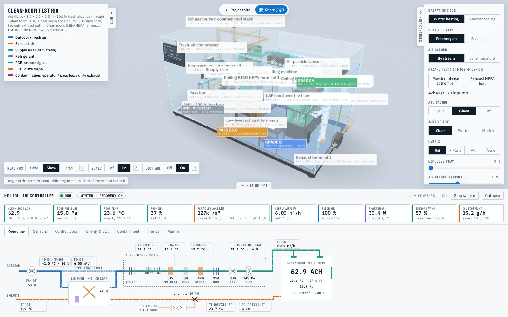

### Hazardous-material design (October 2026)

The rig is designed for **hazardous material**:
- **100 % fresh air, once through.** The AHU has no mixing box, no recirculation dampers or servo, and no extract deck, core or thermal wheel. No exhaust air ever enters the AHU.
- **The exhaust only pre-cools the fresh air**, through the air-pump unit's non-contact **Cu plate core** (copper plates, surface roughness **Ra ≤ 0.8 µm**). This is the only exhaust path.
- **Every terminal is bag-in/bag-out H14 HEPA:**
  - **three ceiling terminals**: terminal 1 over the room, and terminals 2 + 3 above and just behind the operator;
  - an **LAF hood over the vial filler**;
  - the three low-level exhaust terminals.
- **PT-102 watches the exhaust** before it reaches the air pump. If the exhaust is contaminated, **DV-101** diverts it through an **outer BIBO HEPA** (on a shelf beside the fresh-air compressor) and FAN-103B. DV-101 is spring return, so it is fail-safe.
- **One exhaust outlet:** both exhausts leave through a single roof stack at the front-right of the plant room, with a rain cap and a backdraft damper on each branch. The fresh-air compressor's louvre is the only opening in the outdoor wall.
- **All ducts are rectangular.**
- **The filler and operator stand along the right wall.** Ceiling terminals 2 + 3 blow down over the operator, and exhaust terminal 3 at the foot of the wall behind the operator takes that air straight out, so what the operator sheds goes down and away from the filler. The LAF hood gives the Grade A first air over the product.
- **The staging bench sits beside the pass box.**

### Open the simulator
- **Online:** enable GitHub Pages (Settings → Pages → *Deploy from a branch* → `main` / root). The rig is then live at **https://kariemm11.github.io/Cleanroom-Heat-Recovery-Air-Pump/**.
- **Offline:** open `index.html` in a browser. Everything except the web fonts is in this repository: Three.js is in `assets/vendor/`.
- **Not seeing the latest version?** GitHub Pages lets browsers keep a copy for up to 10 minutes after an update. The page detects an old cached copy and reloads itself. If it still looks old, press **Ctrl+Shift+R** (**Cmd+Shift+R** on a Mac).

---

## What is in the box

| Zone | Contents |
|---|---|
| **Plant room** (x < 0) | **AHU, single deck, 100 % fresh air**: outdoor-air pre-filter, fresh-air plenum (no mixing box, no core), panel + bag filters, **pre-heat coil**, cooling coil, droplet eliminator, **reheat coil**, steam humidifier, supply fan, H13 HEPA, attenuator. **Heat-recovery air-pump unit** behind it with the non-contact **Cu plate core** (Ra ≤ 0.8 µm), the exhaust-air coil and FAN-103. R32 compressor, receiver, accumulator, 4-way valve and EEV under the AHU. |
| **Fresh air** | **Fresh-air compressor** (centrifugal, PWM speed) behind a wall louvre → header → **all of it through the air-pump unit's Cu core** → AHU intake. A slide-gated branch straight to the AHU is used only for the baseline test. |
| **Supply** | AHU supply → boot → **riser** (FT-102 airflow) → through the partition → ceiling-void duct → **four H14 bag-in/bag-out terminals**: ceiling terminal 1, the **LAF hood** over the filler, and **ceiling terminals 2 + 3** above and just behind the operator. |
| **Exhaust** | **Three low-level H14 BIBO exhaust terminals**: two in the partition and one low on the right wall, right behind the operator → collector → **PT-102** (particles) → **DV-101** → the air-pump unit's Cu core and evaporator → FAN-103 → **common roof stack**. If PT-102 sees contamination: DV-101 → **outer BIBO HEPA** → FAN-103B → the same stack. Nothing returns to the AHU, and nothing is discharged next to the fresh-air intake. |
| **Clean room** (x > 0) | 492.5 × 490 × 395 mm net (V = 0.0953 m³). Human scale inside is about 1:7. It holds a **vial filling machine** along the right wall under its own LAF hood (infeed turntable, conveyor, 4-needle filling with product tank and peristaltic pump, stoppering, outfeed table, open RABS with glove ports, light tower). There is a **pass box** through the front wall beside the door, with interlocked inner and outer doors and a UV cycle, and a **gowned operator** working at the RABS gloves. An **air particle sensor (PT-101)** on the back wall samples the room air and, through a sample tube, an isokinetic probe beside the filling needles. Also a staging bench, LED luminaire, room T + RH, room ΔP and a hinged access door. The filler and the pass box are stand-alone equipment, not wired to the rig PCB. |
| **Controls** | Main controller PCB (ESP32-S3, 3 × ACS712 current sensors, MOSFET drivers, I²C mux) on the back wall. Every device is reached by a **flat FR4 PCB strip** with copper tracks. **HMI-101**, a 7-inch touch screen, sits on the front face. A 24 V DC supply powers the rig. |

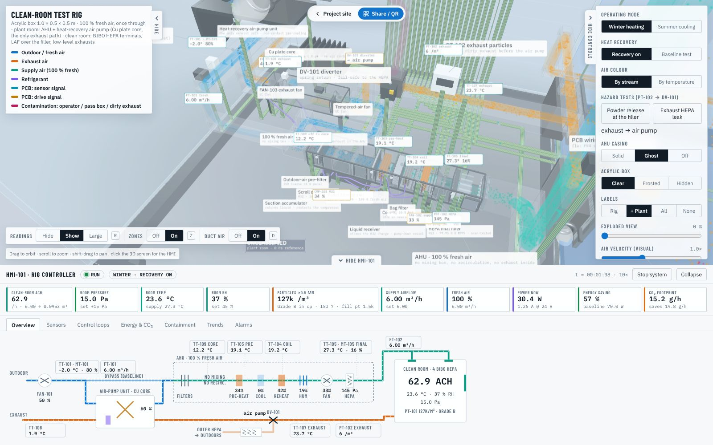

## Sensors, actuators and PCB channels

| Tag | Measures / drives | Device | PCB channel |
|---|---|---|---|
| TT-101 / MT-101 | Fresh-air temperature + humidity | SHT31 on the header | I²C mux ch0, 0x44 |
| FT-101 | Fresh-air flow (for **fresh-air fan speed control**) | Omron D6F-W04A1 | ADC1_CH0 · GPIO1 |
| TT-109 | **Fresh air off the Cu core** (shows the non-contact pre-cooling) | DS18B20 at the AHU inlet | 1-Wire A · GPIO15 |
| TT-103 | **Air after pre-heat** | DS18B20 | 1-Wire A · GPIO15 |
| TT-104 | Air off the cooling coil | DS18B20 | 1-Wire A · GPIO15 |
| TT-105 / MT-105 | **Final supply-air temperature + humidity** | SHT31 after the HEPA | I²C mux ch1, 0x44 |
| FT-102 | **Final supply airflow** → ACH | Omron D6F-W04A1 in the riser | ADC1_CH1 · GPIO2 |
| PDT-101 | **Clean-room pressure** | Sensirion SDP810-125Pa | I²C mux ch2, 0x25 |
| PDT-102 | HEPA ΔP | Sensirion SDP810-500Pa | I²C mux ch3, 0x25 |
| TT-106 / MT-106 | Clean-room temperature + **humidity** | SHT31 | I²C mux ch4, 0x44 |
| PT-101 | **Airborne particles** ≥0.5 µm and ≥5.0 µm: room air and the Grade A fill point | Laser particle counter, 2-port sampling manifold, isokinetic probe at the needles | I²C mux ch5, 0x69 |
| TT-107 | Exhaust air to the air pump | DS18B20 on the exhaust main | 1-Wire B · GPIO16 |
| PT-102 | **Exhaust particles** ≥0.5 µm before DV-101 | SPS30 on the exhaust main (indicative) | I²C mux ch7, 0x69 |
| TT-108 | Exhaust after the air-pump coil | DS18B20 | 1-Wire B · GPIO16 |
| CT-101 / 102 / 103 | **Current**: compressor / fans / reheat + humidifier | ACS712-05B on the PCB | ADC1_CH3-5 · GPIO4-6 |
| VT-101 | DC bus voltage | 100 k / 10 k divider | ADC1_CH6 · GPIO7 |
| FAN-101 | Fresh-air compressor speed | 24 V BLDC blower | PWM GPIO38, tach GPIO10 |
| FAN-102 | Supply fan speed | 24 V EC fan | PWM GPIO39, tach GPIO11 |
| FAN-103 / 103B | Exhaust fan: air-pump unit / outer HEPA (DV-101's end switch picks the one that runs) | 2 × 24 V EC fan | PWM GPIO40, tach GPIO12 |
| DV-101 | **Exhaust diverter**: air pump ⇄ outer BIBO HEPA (spring return, fail-safe to the HEPA) | 24 V spring-return actuator + SPDT end switch | MOSFET GPIO21 |
| CMP-101 / RV-101 / EEV-101 | Air-pump compressor, reversing valve, expansion valve | BLDC driver, relay, stepper | GPIO41 / GPIO42 / GPIO13-14 |
| HTR-101 | Reheat PTC element | 24 V PTC | MOSFET PWM GPIO47 |
| HUM-101 | Steam humidifier | 24 V steam generator | MOSFET PWM GPIO48 |
| HMI-101 | Touch screen | 7-inch HMI display | UART TX17 / RX18 |

## Control loops (running on the measured values)

| Loop | Sensor → actuator | Purpose |
|---|---|---|
| L1 | FT-102 → FAN-102 | Holds the supply airflow, which sets the clean room's ACH |
| L2 | FT-101 → FAN-101 | **Fresh-air header balance**: FAN-101 delivers what FAN-102 draws (100 % fresh air) |
| L3 | PT-102 → DV-101 | **Contaminated-exhaust diverter** (2-position): above 1 000 /m³ for 5 s → exhaust to the outer HEPA (alarm A06); back to the air pump after 60 s below 300 /m³ |
| L4 | TT-103 (winter) / TT-104 (summer) → CMP-101 | **Coil control**: pre-heat coil as the air-pump condenser in winter, cooling coil as its evaporator in summer |
| L5 | TT-105 → HTR-101 | Final supply temperature: desuperheater reheat first (free in summer), then the PTC trim |
| L6 | MT-106 → HUM-101 / coil reset | Clean-room humidity: steam in winter, a lower coil set point in summer |
| L7 | PDT-101 → FAN-103 / 103B | Keeps the clean room at +15 Pa |

Each loop can be switched to **Manual** on the HMI's *Control loops* screen.

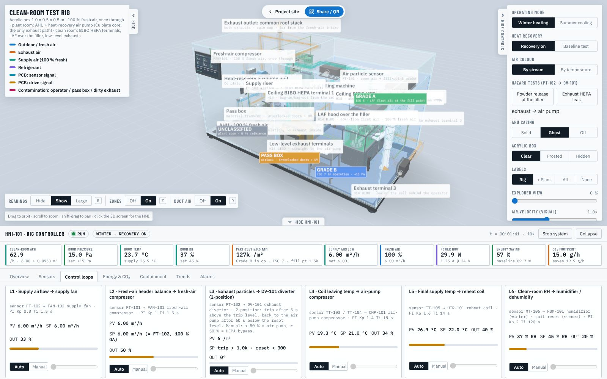

## Energy reduction, carbon footprint and ACH

- **Current sensors.** CT-101…103 measure the compressor, fan and heater channels, and power = V × I.
- **Baseline.** This is the same rig, 100 % fresh air at the same airflow and set points, with the Cu core bypassed: electric pre-heat in winter, a plain chiller (COP editable) in summer, and electric reheat. The simulator runs it as a live twin and shows the saving all the time.
- **CO₂** = electrical energy × grid emission factor. The default is 0.50 kg CO₂/kWh and it is editable. The HMI shows grams per hour, the cumulative total, the yearly figure for the rig, and an indicative scale-up to a 5 000 m³/h AHU.
- **ACH** = final supply airflow ÷ clean-room **volume** = FT-102 (m³/h) ÷ 0.0953 m³. At the default 6 m³/h that is **62.9 /h**, which is in the ISO 7 range. ACH is a rate per hour, so it must divide by volume. Dividing by floor area would give a speed in m/h, not air changes.

Typical results at the default settings, after 30 simulated minutes: about **50 % less power in winter** and **34 % in summer** than the baseline at the same 100 % fresh air. ACH, room pressure and room RH all hold their set points, with no active alarms.

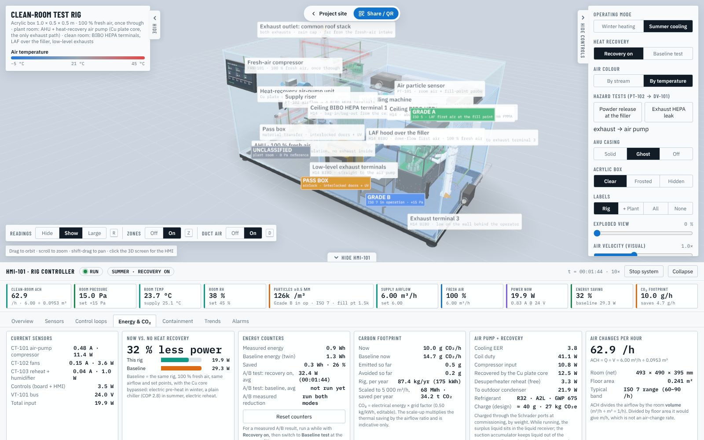

## Refrigerant circuit: where the R32 comes from and where it is stored

The air pump has one sealed R32 circuit, in the machine compartment under the AHU. In **winter** the compressor sends hot gas through the 4-way valve to the **pre-heat coil**, which acts as the condenser. The liquid then goes through the **liquid receiver**, the **filter-drier** and the **sight glass** to the **expansion valve (EEV)**. It boils in the **exhaust-air coil** of the air-pump unit, which acts as the evaporator, and returns through the **suction accumulator** to the compressor. In **summer** the 4-way valve reverses the flow, so the cooling coil becomes the evaporator and the exhaust-air coil becomes the condenser. The purple refrigerant line in 3D shows this, and its dots reverse direction with the season.

| Question | Answer in this rig |
|---|---|
| Where does the refrigerant come from? | It is charged at commissioning from an R32 cylinder through the two **Schrader charging ports**: liquid side at the receiver outlet, suction side at the accumulator inlet. The charge is weighed in. The design charge is about **40 g**, an estimate for a circuit of about 40 W coil duty; confirm it by weighing and by checking the sight glass and superheat at commissioning. |
| Where is it stored while running? | The charge circulates. The **liquid receiver** holds the surplus liquid, so the coils and the EEV always get liquid in both seasons. The **suction accumulator** catches any liquid the evaporator did not boil off (mode change, defrost), so the compressor only takes in vapour. |
| Where is it stored for service? | It is **pumped down into the receiver** (close the liquid valve and run the compressor), or recovered into a recovery cylinder. R32 is never vented (EU F-gas Regulation 2024/573). |
| What keeps it clean? | The bi-flow **filter-drier** removes moisture and acid. The sight glass shows bubbles (short of charge) and its indicator changes colour if moisture gets in. |
| Safety and climate | R32 is class A2L (mildly flammable) with a GWP of 675, so 40 g is 27 kg CO₂e. That is far below the charge limits for room installations in IEC 60335-2-40. |

The receiver, accumulator, filter-drier, sight glass and charging ports are mechanical refrigerant parts with **no PCB connection**. They are in the STEP model and the BOM. The HMI's *Energy & CO₂ → Air pump + recovery* card lists the refrigerant and its charge.

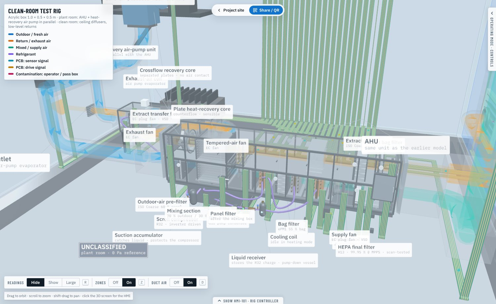

## Contamination containment strategy

The HMI's **Containment** screen shows ten barriers, each with a live status (✓ OK, ! CHECK, ✕ ACTION) worked out from the sensors. The limits are those of EU GMP Annex 1 (2022) and ISO 14644-1. The clean room is Grade B and the fill point under the RABS is Grade A.

| # | Barrier | How the rig does it | Live check |
|---|---|---|---|
| 1 | Pressure cascade | The clean room is held at +15 Pa over the plant room and the lab, so leaks flow outward. PDT-101 drives the exhaust fans (L7). | ≥ 10 Pa OK, 5–10 Pa CHECK, below 5 Pa ACTION |
| 2 | 100 % fresh air, BIBO HEPA on every terminal | Once-through fresh air; panel + bag + H13 in the AHU, then an H14 bag-in/bag-out HEPA at every supply and exhaust terminal. Used filters are bagged out without being touched. | Supply particle count; PDT-102 above 450 Pa means a loaded filter |
| 3 | Dilution and recovery | The air change rate dilutes what people and the process shed. Recovery to 1 % takes 4.6 ÷ ACH hours. | ≥ 40 ACH OK. At 62.9 ACH the 100:1 recovery takes 4.4 min (Annex 1 guide: 15–20 min) |
| 4 | LAF first air at the fill point (Grade A) | The filler runs under its own LAF hood (H14 BIBO, 100 % fresh air), so filtered air reaches the needles first. | PT-101 fill point ≤ 3 520 /m³ (≥0.5 µm) and ≤ 29 /m³ (≥5.0 µm) |
| 5 | Operator and product protection: down-flow over the operator, low-level exhausts | Ceiling terminals 2 + 3 blow down over the operator; exhaust terminal 3 at the foot of the wall behind the operator and the two partition exhausts take the air out at low level. Operator particles go down and away from the filler; the RABS barrier and the LAF hood keep product dust away from the operator. | Shown as pink particles in 3D |
| 6 | Material transfer through the pass box | Two interlocked doors that never open together, with a UV cycle between them. | Door state and transfer count; the inner door adds a short particle burst |
| 7 | People: gowning and glove ports | Grade B gown. Hands enter the RABS only through the glove ports. | Operator particle shedding (editable) |
| 8 | Heat recovery without cross-contamination | The sealed Cu plate core (Ra ≤ 0.8 µm) keeps exhaust and fresh air apart; there is no mixing box and no thermal wheel. | Always OK; the baseline test bypasses the core |
| 9 | Contaminated exhaust: PT-102 → DV-101 → outer HEPA | A release or a leaking exhaust filter throws DV-101: the exhaust goes through a second H14 stage and a roof stack, never through the air pump. Try it with *Hazard tests* in the controls. | PT-102 against the trip level; DV-101 position; alarm A06 |
| 10 | Monitoring, alert and action limits | PT-101 counts all the time. Alert at 70 % of a limit means investigate; action at the limit means stop filling, clean and re-qualify. | Alarms A10 (alert), A11 (room action) and A12 (fill point action) |

| Grade | At rest ≥0.5 µm | At rest ≥5.0 µm | In operation ≥0.5 µm | In operation ≥5.0 µm | ISO (in operation) |
|---|---|---|---|---|---|
| A | 3 520 | 29 | 3 520 | 29 | ISO 5 |
| B | 3 520 | 29 | 352 000 | 2 930 | ISO 7 |
| C | 352 000 | 2 930 | 3 520 000 | 29 300 | ISO 8 |
| D | 3 520 000 | 29 300 | not set | not set | — |

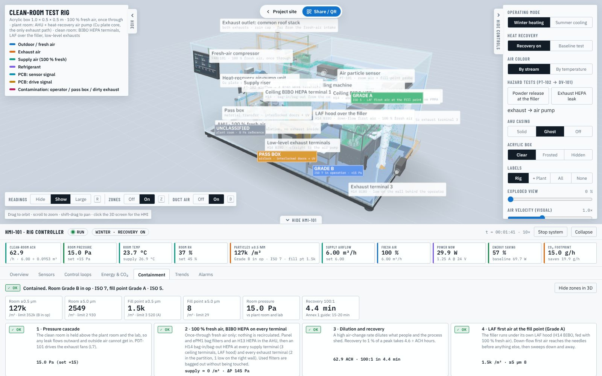

**Particle model.** The clean room is treated as one well-mixed volume:

V · dC/dt = Q<sub>sup</sub> · C<sub>sup</sub> + Q<sub>in</sub> · C<sub>lab</sub> + G − Q<sub>out</sub> · C

- **Supply.** Outdoor air at 2 × 10⁷ /m³ (the pre-filter takes out 10 % at 0.5 µm) passes the bag filter (64 % at 0.5 µm), the AHU's H13 HEPA and an H14 BIBO terminal (each 99.995 % at 0.5 µm). Nothing is recirculated.
- **Exhaust.** After the H14 exhaust terminals PT-102 normally reads only a few particles per m³. A release at the filler or a leaking exhaust filter pushes it over the trip level, and DV-101 sends the exhaust through the outer HEPA.
- **Ingress.** Lab air at 10⁷ /m³ gets in only when the room pressure falls: Q<sub>in</sub> = 0.08 · e<sup>−ΔP/3 Pa</sup> m³/h, plus any reverse leak.
- **Generation.** G is the particles shed by the operator and the line. The default is 12 000 /min at rig scale, editable as *Particles shed ≥0.5 µm /min*. The pass box adds 15 000 /min while its inner door is open.
- **Fill point.** The first air captures 99 % of the room air, so the fill point sees C<sub>sup</sub> + 1 % of C<sub>room</sub>, plus a little from vial handling. The capture falls if the supply airflow drops.

At the defaults, the room reads about 121 000 /m³ (Grade B in operation) and the fill point about 1 500 /m³ (Grade A). Set *Room pressure* to 0 Pa, or raise the shedding, and the alarms and the Containment screen react.

**Containment zones in 3D.** The zones are shown by default, each with a coloured badge: **GRADE A** (green, first air at the fill point), **GRADE B** (blue, the clean room), **PASS BOX** (amber, the airlock) and **UNCLASSIFIED** (grey, the plant room). Each zone is a translucent volume with a floor footprint. Turn them off or on with the *Zones* control at the bottom left of the 3D view, the **Z** key, *Show → Containment zones* or *Show zones in 3D* on the Containment screen. *Contamination particles* shows, in pink, what the operator sheds and what enters through the pass box, carried by the room air to the return grilles.

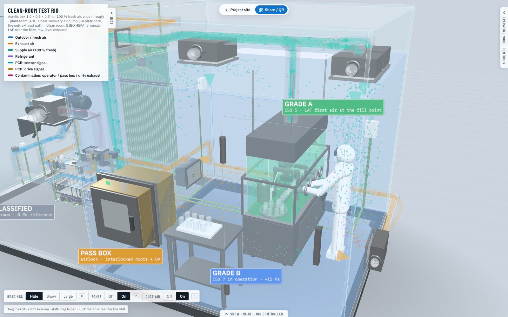

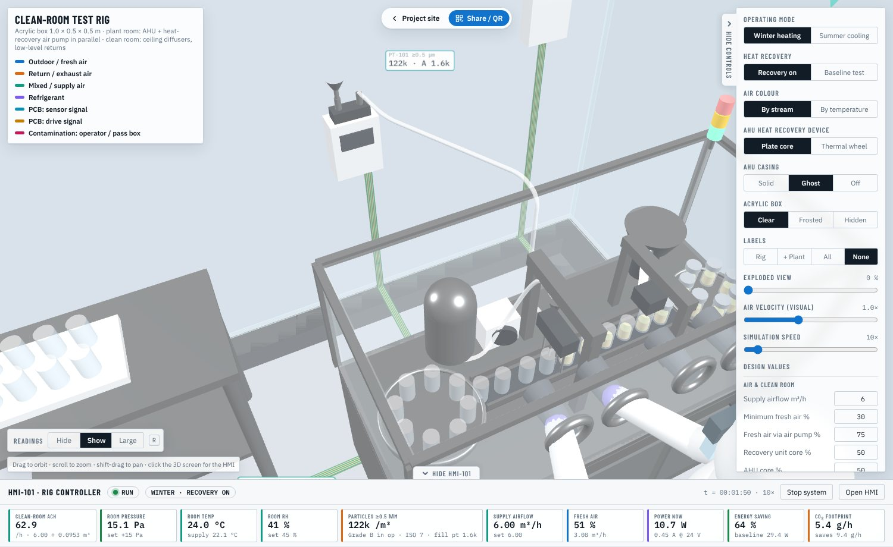

## Using the simulator

- **Drag** to orbit, **scroll/pinch** to zoom, **shift-drag** to pan. Views: Iso / Front / Top / Plant room / Clean room / HMI. **Click the 3D screen** to open the HMI.
- **Air colour**: *By stream* (fresh blue, exhaust orange, supply teal) or *By temperature*, a cold → 21 °C → hot scale driven by the live air states.
- **Every design value is editable**: airflow, the Cu core effectiveness, the PT-102 trip and reset levels, room RH and pressure, heat gain, particles shed in the room, outdoor °C/RH, coil and supply set points, lab temperature, envelope UA, bus voltage, grid factor, baseline COP and hours per year.
- **Hazard tests**: *Powder release at the filler* (60 s) and *Exhaust HEPA leak* show PT-102 tripping DV-101 and the exhaust going through the outer HEPA.
- **HMI screens**: Overview mimic, Sensors (live, with device and PCB channel), Control loops (auto/manual), Energy & CO₂, **Containment**, Trends and Alarms.
- **Trends**: 11 charts over the last 15 minutes of simulated time: air temperatures, humidity, electrical power vs. baseline, ACH, room pressure (with set point), room particles (with the Grade B limit), fill-point particles (with the Grade A limit), airflows, actuator outputs and CO₂ emissions.
- **Readings in 3D**: the *Readings* control at the bottom left of the 3D view switches the live sensor values between **Hide**, **Show** and **Large**. Large is meant for showing the rig to an audience or on a projector. Press **R** to cycle through them. Large also enlarges the zone badges.
- **Air flow in ducts**: a glowing core inside every duct shows the air moving, with chevrons that travel downstream. Their speed follows that duct's live airflow, and their colour follows the air colour mode, by stream or by temperature. Switch it with *Duct air* Off/On at the bottom left of the 3D view, the **D** key or *Show → Air flow in ducts*. It is hidden automatically when a duct carries no air, for example the air-pump lane in the baseline test.

  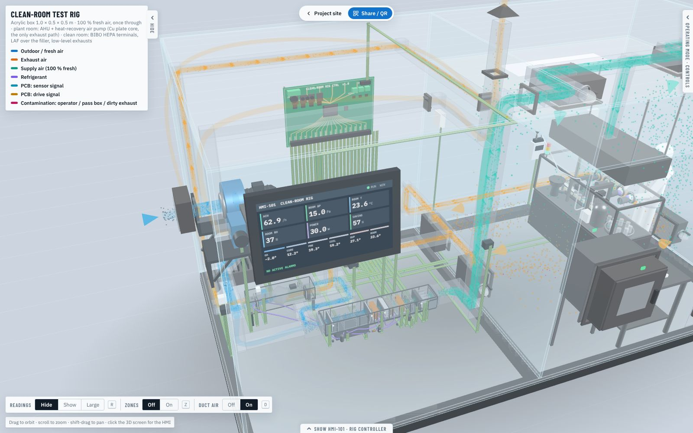
- **Pull-tabs**: *Hide controls* on the left edge of the top-right panel and *Hide HMI-101* on top of the bottom dock slide each panel away, so the 3D view fills the screen. The same tabs bring them back, and clicking the 3D HMI screen also reopens the dock.
- **Share / QR** saves the current setup in a link, for example:
  `index.html?season=summer&flow=8&oat=38&rec=base&color=temp&hide=ribbon`. Add `read=big` for large readings, `zones=off` to start without the zones or `duct=off` without the duct air.

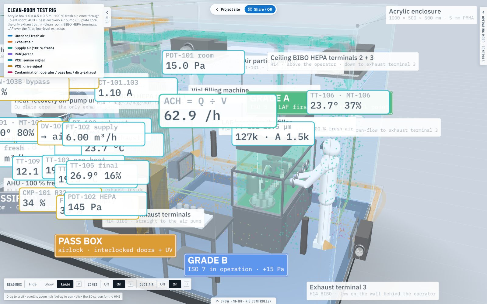

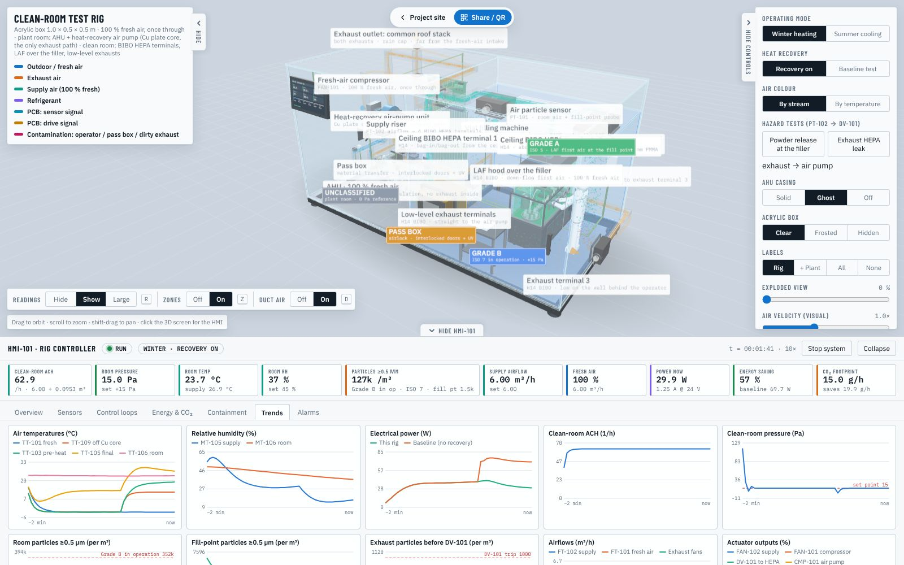

## The CAD model (SolidWorks, AutoCAD)

- [`cad/cleanroom-rig-assembly.step`](cad/cleanroom-rig-assembly.step) is the whole rig as an AP214 STEP file in **mm**. It has **9 sub-assemblies, 181 named parts (298 coloured bodies) and 1 445 solids**, and the overall size is 1057 × 626 × 561 mm (the height includes the HEPA-bypass roof stack; the depth includes collector C outside the back wall). It includes the PT-101 particle counter (probe, sample tube, PCB strip) and the R32 receiver, accumulator, filter-drier, sight glass and charging ports.
- [`cad/step/`](cad/step/) holds one STEP file per sub-assembly: enclosure, AHU, heat-recovery air-pump unit, fresh-air compressor, ductwork, clean room, exhaust safety (PT-102, DV-101, outer HEPA), controls and HMI, PCB wiring harness.
- [`cad/plant-system-AHU-and-air-pump-in-parallel.step`](cad/plant-system-AHU-and-air-pump-in-parallel.step) is **the plant on its own**: the AHU and the heat-recovery air-pump unit working in parallel on one R32 circuit, with the fresh-air compressor, the exhaust safety train and the ducts that join them.
- [`cad/parts/`](cad/parts/) has **one STEP file per part** (181), sorted by sub-assembly.
- [`cad/dwg/`](cad/dwg/) has the **3D DWG files for AutoCAD** (AutoCAD 2018 format, mm, Z up): the whole rig, the plant system, every sub-assembly and every part. Each part is a block on its sub-assembly's layer, in its own colour. [`cad/dxf3d/`](cad/dxf3d/) has the same set as 3D DXF.
- [`cad/dxf/`](cad/dxf/) has the **2D drawings as DXF** (layers VISIBLE, HIDDEN, TEXT, BORDER; mm; first-angle front / top / right-side views): the whole rig, each sub-assembly, every part, and the flat cutting profiles of the 9 acrylic panels. [`cad/drawings/rig-2D-views.pdf`](cad/drawings/rig-2D-views.pdf) collects the assembly and sub-assembly sheets.
- [`cad/BOM.csv`](cad/BOM.csv) lists every part with its size and material.
- [`cad/drawings/enclosure-GA.pdf`](cad/drawings/enclosure-GA.pdf) is the acrylic **fabrication drawing**: panel views, every cut-out with its position, and the cut list.

How to open it in SolidWorks, and how to rebuild it, is in [`cad/README.md`](cad/README.md).

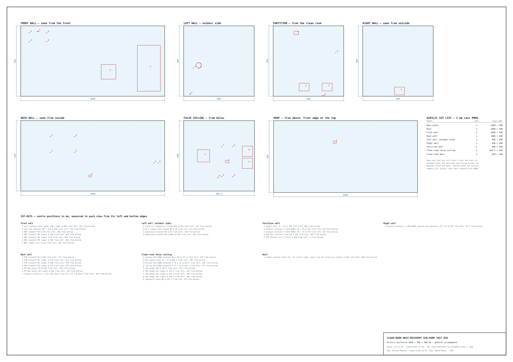

## Build the real rig

The [`build-pack/`](build-pack/README.md) holds everything needed to build it:
- **Wiring:** diagrams, the I/O list, and the PCB and harness pin-outs.
- **Parts:** the electronics BOM.
- **Firmware:** the [`firmware/`](firmware/README.md) for the ESP32-S3, with 6 PI loops and the L3 exhaust diverter, interlocks, alarms, energy and CO₂, the HMI and JSON telemetry. It comes with unit tests.
- **Calculations:** the [engineering calculations](build-pack/07-engineering-calculations.md), covering every equation of the model, duct sizing, fan selection, actuator sizing, the refrigerant circuit and electrical sizing. They are generated by `node tools/calc-report.js` from the simulator's own model.
- **Commissioning:** the commissioning guide and a Web Serial live monitor.

## Repository layout

```
index.html                  simulator page (layout, HMI dock, controls)
assets/js/rig-model.js      plant physics + 7 PI loops + energy/CO₂ + particles (runs in Node too)
assets/js/rig.js            3D scene: earlier AHU + air-pump geometry, rig, air, PCB, HMI
assets/js/share.js          link / QR sharing of the current settings
cad/                        STEP assembly, sub-assemblies, per-part STEP, DXF (2D), BOM, drawings, geometry source
tools/export_geometry.js    dumps the simulator's solids to cad/rig-geometry.json
tools/build_cad.py          rebuilds them as STEP solids (CadQuery / OpenCascade)
tools/make_drawings.py      enclosure fabrication drawing
```

When `assets/js/rig.js` changes, bump the build stamp in three places: `BUILD` in `rig.js`, `data-build` on `#app` in `index.html`, and the `?b=` on the script tags. A browser holding an older page then reloads it instead of mixing old and new files.

The physics model runs headless for testing: `node -e "const R=require('./assets/js/rig-model.js'); const m=R.create(); for(let i=0;i<12000;i++) R.step(m,0.05); console.log(m.kpi)"`.
